# JawaScript

A compiled programming language with Javanese keywords. You write `gawe` for a function, `ayo` for a variable, `yen` and `liyane` for if and else, `kanggo … ing` for loops and `bali` to return, and `jawac` turns it into a native executable.

```rust
// fib.jw
gawe fib(n: wilangan) -> wilangan {
    yen n < 2 {
        bali n
    }
    bali fib(n - 1) + fib(n - 2)
}

gawe utama() {
    kanggo i ing 0..10 {
        tulis("fib(" + i + ") =", fib(i))
    }
}
```

```console
$ jawac run fib.jw
fib(0) = 0
fib(1) = 1
fib(2) = 1
...
fib(9) = 34
```

Under the keywords is a real compiler. The frontend, written in Rust, lexes, parses and type-checks the program. Through a [cxx](https://cxx.rs) bridge, it then builds a custom [MLIR](https://mlir.llvm.org) dialect in C++. The dialect is optimized (constant folding, string-concat fusion, mem2reg), flattened, lowered to LLVM IR and compiled to an object file. That object links with a small C runtime whose heap is managed by the [Boehm garbage collector](https://github.com/ivmai/bdwgc).

## Features

- **Javanese keywords and types.** `wilangan` (integer), `pecahan` (float), `logika` (boolean), `ukara` (string), arrays `[T]`, structs with `wujud`, and `kosong` for null. See the [language reference](docs/language.md).
- **Static types with local inference.** `ayo x = 1` is a `wilangan`; mismatches are compile errors, with hints and "did you mean" suggestions.
- **Optional semicolons.** A line break ends a statement, the way Go does it.
- **Safe at runtime.** Array indexes are bounds-checked, field access checks for `kosong`, and integer division checks for zero. Each error stops the program with a clear message instead of corrupting memory.
- **Garbage collected.** Strings, arrays and structs live on a heap managed by bdwgc; programs never free memory.
- **Optimizing.** Jawa-specific passes run in MLIR before LLVM's `-O2`. Bounds checks that LLVM can prove redundant disappear, and loops vectorize.
- **Inspectable.** `--emit` stops at any stage: the `jawa` dialect, the optimized dialect, the LLVM dialect, LLVM IR or an object file.

## The language at a glance

| Jawa | Meaning | Usually written as |
| --- | --- | --- |
| `gawe f(x: wilangan) -> wilangan { … }` | *make, do* | `fn` / `function` |
| `ayo x = 1` | *let's* | `let` (can change) |
| `tetep x = 1` | *stays the same* | `const` |
| `yen … { } liyane yen … { } liyane { }` | *if … otherwise* | `if / else if / else` |
| `sajrone kahanan { }` | *during* | `while` |
| `kanggo i ing 0..10 { }`, `kanggo x ing xs { }` | *for … in* | `for … in` |
| `mandheg`, `terusna` | *stop*, *carry on* | `break`, `continue` |
| `bali x` | *go back* | `return` |
| `bener`, `salah` | *true*, *wrong* | `true`, `false` |
| `lan`, `utawa`, `ora` | *and*, *or*, *not* | `&&`, `\|\|`, `!` |
| `wujud Titik { x: pecahan }` | *shape, form* | `struct` |
| `kosong` | *empty* | `null` |
| `tulis(…)`, `dawane(x)`, `tambah(xs, x)`, `gagal(pesen)` | *write*, *its length*, *add*, *fail* | print, len, push, panic |

Programs start at `gawe utama()` (*utama*: main).

## Examples

Every program in [`examples/`](examples) runs, and the test suite checks its output.

| Example | What it shows |
| --- | --- |
| [`sugeng_rawuh.jw`](examples/sugeng_rawuh.jw) | Hello, world: *sugeng rawuh* means welcome |
| [`fibonacci.jw`](examples/fibonacci.jw) | Recursion, and building an array in a loop |
| [`fizzbuzz.jw`](examples/fizzbuzz.jw) | FizzBuzz on a gamelan: gong and kendhang |
| [`collatz.jw`](examples/collatz.jw) | `sajrone` loops |
| [`weton.jw`](examples/weton.jw) | The Javanese day of birth: weekday, pasaran and neptu for any date |
| [`aksara.jw`](examples/aksara.jw) | The Hanacaraka in aksara Jawa (ꦲꦤꦕꦫꦏ), with UTF-8 strings |
| [`dhaptar.jw`](examples/dhaptar.jw) | Structs and a linked list |
| [`urutan.jw`](examples/urutan.jw) | Quicksort on an array |
| [`prima.jw`](examples/prima.jw) | The sieve of Eratosthenes |
| [`tembung.jw`](examples/tembung.jw) | Joining, converting and comparing text |

```console
$ jawac run examples/weton.jw
17-8-1945: Jemuwah Legi, neptu 11
28-10-1928: Minggu Wage, neptu 9
1-1-2000: Setu Legi, neptu 14
14-10-2026: Rebo Wage, neptu 11
```

## How it works

```mermaid
flowchart LR
    src[".jw source"] --> lex["Lexer"] --> parse["Parser"] --> sema["Type checker"]
    sema -->|typed HIR| cg["Code generator"]
    cg -->|cxx bridge| jawa["jawa dialect"]
    jawa --> opt["canonicalize, jawa-fuse-concat, CSE"]
    opt --> flat["jawa-flatten-cfg, mem2reg"]
    flat --> lower["convert-jawa-to-llvm"]
    lower --> llvm["LLVM IR, -O2"]
    llvm --> obj["object file"]
    obj --> link["link with jawa_rt + bdwgc"]
    link --> exe["executable"]

    subgraph Rust
        lex
        parse
        sema
        cg
    end
    subgraph "C++ / MLIR / LLVM"
        jawa
        opt
        flat
        lower
        llvm
        obj
    end
```



The [`jawa` dialect](include/jawa/Dialect/Jawa/IR/JawaOps.td) keeps the shape of the source, in the spirit of ClangIR. Structured `jawa.if`, `jawa.while` and `jawa.for` can hold `jawa.break`, `jawa.continue` and `jawa.return` at any depth. Strings, arrays and structs are garbage-collected reference types, and checked operations model their traps as side effects so the optimizer never deletes them. [docs/architecture.md](docs/architecture.md) walks one program through every stage.

## Building from source

You need:

- LLVM and MLIR 23, with `mlir-tblgen` and FileCheck
- Clang and LLD (recommended; required on Windows)
- CMake 3.24 or newer, and Ninja
- Rust 1.80 or newer, with Cargo
- bdwgc (the Boehm-Demers-Weiser garbage collector)
- Python 3, for the `lit` test runner

### Linux (Ubuntu 24.04)

```sh
wget https://apt.llvm.org/llvm.sh && sudo bash llvm.sh 23
sudo apt install libmlir-23-dev mlir-23-tools llvm-23-tools lld-23 clang-23 \
    libgc-dev cmake ninja-build python3-venv
export PATH=/usr/lib/llvm-23/bin:$PATH

git clone https://github.com/fzn0x/jawascript.git
cd jawascript
CC=clang CXX=clang++ CMAKE_ARGS="-DLLVM_USE_LINKER=lld" scripts/build.sh
```

Install Rust with [rustup](https://rustup.rs) if you don't have it.

### Windows (MSYS2)

Open the **MSYS2 UCRT64** shell and run:

```sh
pacman -S --needed git mingw-w64-ucrt-x86_64-{clang,lld,cmake,ninja,mlir,llvm,llvm-tools,gc,rust,python}

git clone https://github.com/fzn0x/jawascript.git
cd jawascript
scripts/build.sh
```

The script picks Clang and LLD automatically under MSYS2, because MSYS2's MLIR libraries are built with them. Programs built with `jawac` on Windows link the collector statically, so they run without any extra DLLs.

### Using it

The build leaves `jawac` and `jawa-opt` in `build/bin`:

```sh
build/bin/jawac run examples/fibonacci.jw     # compile and run
build/bin/jawac examples/fibonacci.jw         # writes ./fibonacci (fibonacci.exe on Windows)
build/bin/jawac check examples/fibonacci.jw   # type-check only
build/bin/jawac --emit=mlir-opt examples/fibonacci.jw   # look at the optimized IR
```

| Option | Meaning |
| --- | --- |
| `-o <path>` | Where to write the output |
| `-O0` … `-O3` | Optimization level (default `-O2`) |
| `--emit <kind>` | `exe` (default), `obj`, `llvm`, `mlir`, `mlir-opt` or `mlir-llvm` |
| `--color <when>` | `auto`, `always` or `never` |

`cmake --install build --prefix ~/.local` installs `jawac` with its runtime next to it.

## Testing

```sh
scripts/test.sh
```

This builds, runs the frontend's Rust unit tests (lexer, parser, type checker), then runs the [lit](https://llvm.org/docs/CommandGuide/lit.html) suite with FileCheck:

| Directory | What it covers |
| --- | --- |
| `tests/Dialect` | The dialect's syntax, verifiers and folders, and each Jawa pass in isolation, through `jawa-opt` |
| `tests/Conversion` | The lowering to the LLVM dialect: runtime calls, inline checks, string globals |
| `tests/Frontend` | The IR `jawac` emits at each stage |
| `tests/Diagnostics` | Compile errors, warnings and hints |
| `tests/Run` | Compiled programs, at `-O0` and `-O2`, including every runtime error and a garbage collector stress test |
| `tests/Examples` | The output of every example |
| `tests/Driver` | The command line |

## Project layout

| Path | What it holds |
| --- | --- |
| `crates/jawa-frontend` | Lexer, parser, type checker and typed HIR (Rust) |
| `crates/jawac` | The driver, the HIR-to-MLIR code generator, and the Rust side of the cxx bridge |
| `include/jawa`, `lib` | The C++ side: the `jawa` dialect (TableGen and C++), its passes, the LLVM lowering, the pipeline, and the bridge |
| `tools/jawac`, `tools/jawa-opt` | The compiler executable and an `mlir-opt` for the dialect |
| `runtime` | `jawa_rt`: strings, arrays, printing and runtime errors, on bdwgc |
| `examples` | Runnable Jawa programs |
| `tests` | The lit suite |
| `docs` | The language reference and the architecture guide |
| `scripts` | `build.sh` and `test.sh` |

## Contributing

Bug reports, ideas and pull requests are welcome. Please read [CONTRIBUTING.md](CONTRIBUTING.md) first. To report a security problem, follow [SECURITY.md](SECURITY.md) rather than opening a public issue.

## License

[MIT](LICENSE) © fzn0x
