# JawaScript

[](https://github.com/fzn0x/jawascript/actions/workflows/ci.yml)

<p align="center">
  
</p>

**JawaScript** is a compiled programming language that reads like JavaScript and TypeScript, written in Javanese. You write `gawe` for a function, `ayo` and `tetep` for `let` and `const`, `yen` and `liyane` for if and else, `kanggo` for loops and `bali` to return. `jawac`, the JawaScript compiler, turns your `.jw` file into a native executable.

```ts
// fib.jw
gawe fib(n: wilangan): wilangan {
    yen (n < 2) {
        bali n
    }
    bali fib(n - 1) + fib(n - 2)
}

gawe utama() {
    kanggo (ayo i = 0; i < 10; i++) {
        tulis(`fib(${i}) = ${fib(i)}`)
    }
}
```

```console
$ build/bin/jawac run fib.jw
fib(0) = 0
fib(1) = 1
fib(2) = 1
fib(3) = 2
fib(4) = 3
fib(5) = 5
fib(6) = 8
fib(7) = 13
fib(8) = 21
fib(9) = 34
```

Under the keywords is a real compiler. A Rust frontend lexes, parses and type-checks the program. Through a [cxx](https://cxx.rs) bridge, it then builds a custom [MLIR](https://mlir.llvm.org) dialect in C++, which is optimized, lowered to LLVM IR and compiled to machine code. The result links with a small C runtime whose memory is managed by the [Boehm garbage collector](https://github.com/ivmai/bdwgc).

- [Getting started](#getting-started)
- [Coming from JavaScript or TypeScript](#coming-from-javascript-or-typescript)
- [Examples](#examples)
- [Using jawac](#using-jawac)
- [How it works](#how-it-works)
- [Testing](#testing)
- [Troubleshooting](#troubleshooting)

## Getting started

These steps take you from a fresh clone to running your own program. The first build compiles the compiler itself and takes a few minutes; after that, compiling a Jawa program takes a fraction of a second.

### 1. Install the tools

JawaScript needs LLVM and MLIR 23, Clang and LLD, CMake, Ninja, Rust, the Boehm garbage collector (bdwgc) and Python 3.

**Windows.** Install [MSYS2](https://www.msys2.org) (the default location, `C:\msys64`, is assumed below), open the **MSYS2 UCRT64** shell from the Start menu, and run:

```sh
pacman -S --needed git mingw-w64-ucrt-x86_64-{clang,lld,cmake,ninja,mlir,llvm,llvm-tools,gc,rust,python,python-pip}
```

Run all the commands below in that **MSYS2 UCRT64** shell. To use Git Bash, PowerShell or VS Code's terminal instead, see [Troubleshooting](#troubleshooting).

**Ubuntu or Debian:**

```sh
wget https://apt.llvm.org/llvm.sh && sudo bash llvm.sh 23
sudo apt install libmlir-23-dev mlir-23-tools llvm-23-tools lld-23 clang-23 \
    libgc-dev cmake ninja-build python3-venv
export PATH=/usr/lib/llvm-23/bin:$PATH     # add this line to ~/.bashrc too
```

Install Rust with [rustup](https://rustup.rs) if you don't have it.

### 2. Clone and build

```sh
git clone https://github.com/fzn0x/jawascript.git
cd jawascript
scripts/build.sh
```

On Ubuntu, build with Clang and LLD:

```sh
CC=clang CXX=clang++ CMAKE_ARGS="-DLLVM_USE_LINKER=lld" scripts/build.sh
```

The build leaves the compiler at `build/bin/jawac` (`jawac.exe` on Windows).

### 3. Run your first program

Create a file called `halo.jw`:

```ts
gawe utama() {
    tetep jeneng = "Jawa"
    tulis(`Sugeng rawuh, ${jeneng}!`)
}
```

and run it:

```sh
build/bin/jawac run halo.jw
```

```console
Sugeng rawuh, Jawa!
```

`jawac run` compiles the program to a temporary executable and runs it.

### 4. Build an executable

```sh
build/bin/jawac halo.jw        # writes ./halo (halo.exe on Windows)
./halo
```

The executable stands on its own: on Windows it needs no MSYS2 or DLLs, so you can copy it to another machine and run it.

### 5. Put jawac on your PATH (optional)

So you can type `jawac` from anywhere, add the build directory to your `PATH`:

```sh
echo "export PATH=\"$PWD/build/bin:\$PATH\"" >> ~/.bashrc
source ~/.bashrc
jawac run examples/weton.jw
```

### 6. Explore

- Run the [examples](#examples): `build/bin/jawac run examples/aksara.jw`.
- Read the [language reference](docs/language.md) for everything Jawa can do.
- See how the compiler works in [docs/architecture.md](docs/architecture.md).

## Coming from JavaScript or TypeScript

The punctuation is the same; the words are Javanese.

| JavaScript / TypeScript | JawaScript | Javanese meaning |
| --- | --- | --- |
| `function f(n: number): number { }` | `gawe f(n: wilangan): wilangan { }` | *gawe*: make, do |
| `let x = 1`, `const y = 2` | `ayo x = 1`, `tetep y = 2` | *ayo*: let's; *tetep*: stays the same |
| `if (c) { } else if (d) { } else { }` | `yen (c) { } liyane yen (d) { } liyane { }` | *yen*: if; *liyane*: the other |
| `while (c) { }` | `sajrone (c) { }` | *sajrone*: during |
| `for (let i = 0; i < n; i++) { }` | `kanggo (ayo i = 0; i < n; i++) { }` | *kanggo*: for |
| `for (const x of larik) { }` | `kanggo (tetep x ing larik) { }` | *ing*: in |
| `break`, `continue`, `return x` | `mandheg`, `terusna`, `bali x` | stop, carry on, go back |
| `true`, `false`, `null` | `bener`, `salah`, `kosong` | right, wrong, empty |
| `&&`, `\|\|`, `!`, `===` | the same, or `lan`, `utawa`, `ora`, `==` | and, or, not |
| `` `n = ${n}` `` | the same | |
| `console.log(a, b)` | `tulis(a, b)` | *tulis*: write |
| `larik.length`, `larik.push(x)` | `dawane(larik)`, `tambah(larik, x)` | its length, add |
| `throw new Error(msg)` | `gagal(msg)` | *gagal*: fail |
| `number` | `wilangan` (integer) or `pecahan` (float) | number, fraction |
| `string`, `boolean`, `number[]` | `ukara`, `logika`, `wilangan[]` | sentence, logic |
| `interface Point { x: number }` | `wujud Titik { x: pecahan }` | *wujud*: shape, form |

Programs start at `gawe utama()` (*utama*: main). Types are checked when you compile, integers and floats are separate types, and there are no classes or closures. If you type a JavaScript word by habit, the compiler tells you the Jawa one:

```console
$ build/bin/jawac check habits.jw
error: `let` is not a Jawa keyword
 --> habits.jw:2:5
  |
2 |     let x = 1
  |     ^^^
  = note: Jawa writes `let` as `ayo`
```

Jawa also has spellings of its own: `kanggo i ing 0..10` loops over a range, and `ora`, `lan` and `utawa` read as words. The [language reference](docs/language.md) covers all of it.

## Examples

Every program in [`examples/`](examples) runs, and the test suite checks its output.

| Example | What it shows |
| --- | --- |
| [`sugeng_rawuh.jw`](examples/sugeng_rawuh.jw) | Hello, world: *sugeng rawuh* means welcome |
| [`fibonacci.jw`](examples/fibonacci.jw) | Recursion, and building an array in a loop |
| [`fizzbuzz.jw`](examples/fizzbuzz.jw) | FizzBuzz on a gamelan: gong and kendhang |
| [`collatz.jw`](examples/collatz.jw) | `sajrone` loops and template strings |
| [`weton.jw`](examples/weton.jw) | The Javanese day of birth: weekday, pasaran and neptu for any date |
| [`aksara.jw`](examples/aksara.jw) | The Hanacaraka in aksara Jawa (ꦲꦤꦕꦫꦏ), with UTF-8 strings |
| [`dhaptar.jw`](examples/dhaptar.jw) | Structs and a linked list |
| [`urutan.jw`](examples/urutan.jw) | Quicksort on an array |
| [`prima.jw`](examples/prima.jw) | The sieve of Eratosthenes |
| [`tembung.jw`](examples/tembung.jw) | Joining, converting and comparing text |

```console
$ build/bin/jawac run examples/weton.jw
17-8-1945: Jemuwah Legi, neptu 11
28-10-1928: Minggu Wage, neptu 9
1-1-2000: Setu Legi, neptu 14
14-10-2026: Rebo Wage, neptu 11
```

## Using jawac

```sh
jawac run file.jw              # compile and run
jawac file.jw                  # build an executable next to you: ./file or file.exe
jawac file.jw -o out           # choose the executable's name
jawac check file.jw            # only check for errors
jawac --emit=mlir-opt file.jw  # look at the optimized IR
```

| Option | Meaning |
| --- | --- |
| `-o <path>` | Where to write the output |
| `-O0` … `-O3` | Optimization level (default `-O2`) |
| `--emit <kind>` | `exe` (default), `obj`, `llvm`, `mlir`, `mlir-opt` or `mlir-llvm`; text goes to standard output unless `-o` is given |
| `--color <when>` | `auto`, `always` or `never` |
| `-h`, `--help` / `-V`, `--version` | Help and version |

`jawac` links programs with the C compiler it was built with. The environment variables `JAWA_CC` and `JAWA_RUNTIME_LIB` override the compiler and the path to the runtime library. `cmake --install build --prefix ~/.local` installs `jawac` with its runtime next to it.

## How it works

```mermaid
flowchart LR
    src[".jw source"] --> lex["Lexer"] --> parse["Parser"] --> sema["Type checker"]
    sema -->|typed HIR| cg["Code generator"]
    cg -->|cxx bridge| jawa["jawa dialect"]
    jawa --> opt["canonicalize, jawa-fuse-concat, CSE"]
    opt --> flat["jawa-flatten-cfg, mem2reg"]
    flat --> lower["convert-jawa-to-llvm"]
    lower --> llvm["LLVM IR, -O2"]
    llvm --> obj["object file"]
    obj --> link["link with jawa_rt + bdwgc"]
    link --> exe["executable"]

    subgraph Rust
        lex
        parse
        sema
        cg
    end
    subgraph "C++ / MLIR / LLVM"
        jawa
        opt
        flat
        lower
        llvm
        obj
    end
```



- **A Rust frontend** (`crates/jawa-frontend`): the lexer handles optional semicolons and template strings, the parser reports every error in one run without cascades, and the type checker infers types and suggests fixes.
- **A type-safe bridge** (`crates/jawac/src/bridge.rs`): the frontend builds MLIR through cxx, with shared enums and typed handles.
- **A custom MLIR dialect** (`include/jawa/Dialect/Jawa`). In the spirit of ClangIR, it keeps structured `jawa.if`, `jawa.while` and `jawa.for` with `break`, `continue` and `return` at any depth. It has garbage-collected strings, arrays and structs, and checked operations whose traps the optimizer never removes.
- **Jawa-specific passes.** `jawa-fuse-concat` builds `"a" + b + "c"` with one allocation, `jawa-flatten-cfg` lowers structured control flow, and MLIR's `mem2reg` promotes variables to SSA through the dialect's memory slot interfaces.
- **The LLVM lowering** puts bounds, null and division-by-zero checks inline, and leaves no undefined behaviour for LLVM to exploit. LLVM's `-O2` then removes the checks it can prove redundant and vectorizes loops.
- **A runtime on the Boehm GC** (`runtime/jawa_rt.c`), so programs never free memory.

[docs/architecture.md](docs/architecture.md) walks one program through every stage, with the real IR.

## Testing

```sh
scripts/test.sh
```

This builds, runs the frontend's Rust unit tests, then runs the [lit](https://llvm.org/docs/CommandGuide/lit.html) and FileCheck suite. It installs `lit` into a virtualenv in `build/` if it isn't on your `PATH`, and passes extra arguments to lit (`scripts/test.sh --filter Run/`).

| Directory | What it covers |
| --- | --- |
| `tests/Dialect` | The dialect's syntax, verifiers and folders, and each Jawa pass in isolation, through `jawa-opt` |
| `tests/Conversion` | The lowering to the LLVM dialect: runtime calls, inline checks, string globals |
| `tests/Frontend` | The IR `jawac` emits at each stage |
| `tests/Diagnostics` | Compile errors, warnings and hints, including JavaScript habits |
| `tests/Run` | Compiled programs at `-O0` and `-O2`, including every runtime error and a garbage collector stress test |
| `tests/Examples` | The output of every example |
| `tests/Driver` | The command line |

## Troubleshooting

**`error while loading shared libraries: libLLVM-23.dll`** (Windows). `jawac.exe` uses LLVM's DLLs from MSYS2. The MSYS2 UCRT64 shell finds them; Git Bash, PowerShell and VS Code's terminal need the folder on `PATH` first:

```sh
export PATH=/c/msys64/ucrt64/bin:$PATH          # Git Bash
```

```powershell
$env:Path = "C:\msys64\ucrt64\bin;$env:Path"    # PowerShell
```

Add the line to `~/.bashrc` (Git Bash) or your PowerShell profile to make it permanent. Programs that `jawac` builds don't need this.

**CMake cannot find MLIR.** Point it at MLIR's CMake files, for example `CMAKE_ARGS="-DMLIR_DIR=/usr/lib/llvm-23/lib/cmake/mlir" scripts/build.sh`. `scripts/build.sh` configures only once, so delete `build/` first.

**Link errors about COMDAT or typeinfo on Windows.** MSYS2's MLIR is built with Clang and LLD, and the C++ side must be too. `scripts/build.sh` does this for you under MSYS2; if you configure by hand, pass `-DCMAKE_C_COMPILER=clang -DCMAKE_CXX_COMPILER=clang++ -DLLVM_USE_LINKER=lld`.

**`cannot find the Jawa runtime`.** `jawac` looks for `libjawa_rt.a` in `../lib` next to itself. Rebuild with `scripts/build.sh`, or set `JAWA_RUNTIME_LIB` to the file.

**Something odd after `git pull`.** Run `scripts/build.sh` again; if it persists, delete `build/` and rebuild.

## Project layout

| Path | What it holds |
| --- | --- |
| `crates/jawa-frontend` | Lexer, parser, type checker and typed HIR (Rust) |
| `crates/jawac` | The driver, the HIR-to-MLIR code generator, and the Rust side of the cxx bridge |
| `include/jawa`, `lib` | The C++ side: the `jawa` dialect (TableGen and C++), its passes, the LLVM lowering, the pipeline, and the bridge |
| `tools/jawac`, `tools/jawa-opt` | The compiler executable and an `mlir-opt` for the dialect |
| `runtime` | `jawa_rt`: strings, arrays, printing and runtime errors, on bdwgc |
| `examples` | Runnable Jawa programs |
| `tests` | The lit suite |
| `docs` | The language reference and the architecture guide |
| `assets` | The README image |
| `scripts` | `build.sh` and `test.sh` |

## Contributing

Bug reports, ideas and pull requests are welcome. Please read [CONTRIBUTING.md](CONTRIBUTING.md) first. To report a security problem, follow [SECURITY.md](SECURITY.md) rather than opening a public issue.

## License

[MIT](LICENSE) © fzn0x
