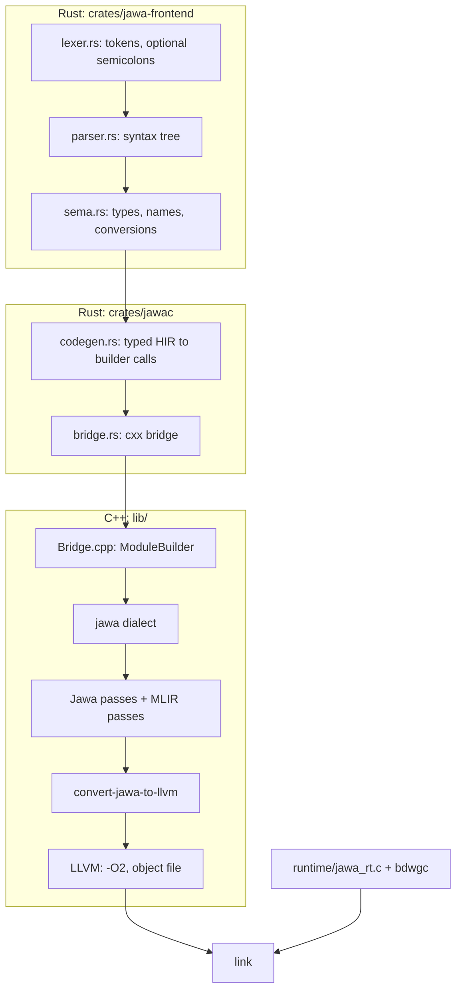

# How jawac works

This guide follows one small program through every stage of the compiler:

```rust
gawe jumlah(xs: wilangan[]): wilangan {
    ayo total = 0
    kanggo x ing xs {
        total += x
    }
    bali total
}

gawe utama() {
    tulis("jumlah:", jumlah([1, 2, 3]))
}
```



## 1. The Rust frontend

`crates/jawa-frontend` has no dependencies and its own unit tests (`cargo test -p jawa-frontend`).

- **Lexer** (`lexer.rs`). Besides tokens, it inserts statement terminators at line breaks the way Go does. It also stops one mistake from spoiling the rest of the file: a line that starts with a statement keyword closes any parenthesis left open above it, and C-style `&&`, `||` and `!` are reported but read as `lan`, `utawa` and `ora`.
- **Parser** (`parser.rs`). A recursive-descent parser that collects every error rather than stopping at the first, skipping to the end of a bad statement. It caps nesting depth so hostile input cannot overflow the stack.
- **Type checker** (`sema.rs`). It resolves names and checks types, and lowers the syntax tree to a typed HIR (`hir.rs`) in which every expression has its type. Implicit conversions, such as `"umur: " + 20`, become explicit nodes, and operators are split by what they operate on. It also checks that functions return on every path, and suggests the closest name for typos.

## 2. Across the bridge

`crates/jawac` is a static library linked into the `jawac` executable, whose C++ `main` calls the Rust `jawac_main`. The code generator (`codegen.rs`) walks the HIR and calls a C++ `ModuleBuilder` through a [cxx](https://cxx.rs) bridge (`bridge.rs`, `include/jawa/Bridge/Bridge.h`):

- Operators, predicates, casts and output kinds are **shared enums**, checked on both sides at compile time.
- Values and types cross as `u32` **handles** into tables the C++ side keeps. `Bridge.h` therefore needs no MLIR headers, and the generated glue compiles without them. On the Rust side, `builder.rs` wraps the handles in distinct `Value`, `Slot` and `TypeId` types, so they cannot be mixed up.
- Structured control flow is built in the order the frontend walks it: `begin_if` … `begin_else` … `end_if`, and so on.

CMake builds the crate with Cargo, passing its C and C++ compilers through so the bridge glue matches the backend. The Rust library and the C++ bridge call each other, so CMake links them as a cycle.

## 3. The jawa dialect

The frontend's output keeps the shape of the source (`jawac --emit=mlir`):

```mlir
func.func private @jumlah(%arg0: !jawa.array<i64>) -> i64 {
  %0 = jawa.alloca "xs" : !jawa.ptr<!jawa.array<i64>>
  %1 = jawa.alloca "total" : !jawa.ptr<i64>
  %2 = jawa.alloca "indeks" : !jawa.ptr<i64>
  %3 = jawa.alloca "x" : !jawa.ptr<i64>
  jawa.store %arg0, %0 : !jawa.ptr<!jawa.array<i64>>
  %4 = jawa.const 0 : i64
  jawa.store %4, %1 : !jawa.ptr<i64>
  %5 = jawa.load %0 : !jawa.ptr<!jawa.array<i64>>
  %6 = jawa.const 0 : i64
  jawa.store %6, %2 : !jawa.ptr<i64>
  jawa.for {
    %8 = jawa.load %2 : !jawa.ptr<i64>
    %9 = jawa.array_len %5 : !jawa.array<i64>
    %10 = jawa.cmp lt, %8, %9 : i64
    jawa.condition(%10)
  } do {
    %8 = jawa.load %2 : !jawa.ptr<i64>
    %9 = jawa.array_get %5[%8] : !jawa.array<i64> -> i64
    jawa.store %9, %3 : !jawa.ptr<i64>
    ...
    jawa.yield
  } step {
    ...
    jawa.yield
  }
  %7 = jawa.load %1 : !jawa.ptr<i64>
  jawa.return %7 : i64
}
```

The dialect is defined in TableGen under `include/jawa/Dialect/Jawa/IR`. Some design decisions:

- **Structured control flow, like ClangIR.** `jawa.if`, `jawa.while` and `jawa.for` hold regions, and `jawa.break`, `jawa.continue` and `jawa.return` may appear at any depth inside them. `jawa.for` has a `step` region, so `terusna` can jump to the step and still advance the counter. Verifiers check that each region ends in an allowed terminator, and that `break` and `continue` sit in a loop body.
- **Reference types.** `!jawa.str`, `!jawa.array<T>` and `!jawa.struct<"Name">` live on the garbage-collected heap. Structs are nominal: the type names a `jawa.struct @Name {…}` definition holding the fields, which lets a struct refer to itself. Field accesses check their index and types against it through `SymbolUserOpInterface`.
- **Traps are side effects.** `jawa.div` and `jawa.rem` on integers report a write effect unless the divisor is a known non-zero constant, and `array_get` and `get_field` read and write. The optimizer therefore never removes an operation that would stop the program, while `jawa.add` and friends stay `Pure`.
- **Folding.** Arithmetic, comparisons, casts, `to_str`, `str_len` and `concat` fold constants. `"umur: " + 42` folds to `"umur: 42"`, and its length to 8. Integer folding follows the runtime's rules: `MIN / -1` wraps, and division by zero is left for the program to report.
- **Local variables** are `jawa.alloca` slots in the entry block, with `jawa.load` and `jawa.store`. The three ops implement MLIR's memory slot interfaces (`JawaMemorySlot.cpp`), so the generic `mem2reg` pass can promote them.
- **Inlining.** The dialect has an inliner interface, but forbids inlining `jawa.return` before flattening, since it would return from the caller.

`jawa-opt`, an `mlir-opt` for the dialect, runs any of this in isolation; the tests in `tests/Dialect` use it.

## 4. Optimizing and flattening

At `-O1` and above, `JawaPipeline` (`lib/Pipeline/Pipeline.cpp`) runs:

1. `canonicalize`, then **`jawa-fuse-concat`**, then `cse`, while the structure is still visible. `jawa-fuse-concat` rewrites a chain like `"jeneng: " + jeneng + ", umur: " + umur`, which arrives as nested binary concats each allocating an intermediate string, into one n-ary `jawa.concat` that the runtime builds with a single allocation. It also joins neighbouring constant pieces.
2. **`jawa-flatten-cfg`**, at every level. It inlines the regions of structured ops into the function, innermost first, and joins them with `cf.br` and `cf.cond_br`. A `jawa.break` becomes a branch to the loop's exit, a `jawa.continue` a branch to its latch, and `jawa.return` becomes `func.return`. Because inner ops are flattened first, every `break` left in a loop's body belongs to that loop.
3. `mem2reg`, `canonicalize` and `cse` on the flat CFG: variables become SSA values and block arguments.
4. `symbol-dce`: every function but `utama` is private, so unused ones disappear.

After this (`jawac --emit=mlir-opt`), the loop counter and the total are block arguments:

```mlir
func.func private @jumlah(%arg0: !jawa.array<i64>) -> i64 {
  %0 = jawa.const 1 : i64
  %1 = jawa.const 0 : i64
  cf.br ^bb1(%1, %1 : i64, i64)
^bb1(%2: i64, %3: i64):  // 2 preds: ^bb0, ^bb2
  %4 = jawa.array_len %arg0 : !jawa.array<i64>
  %5 = jawa.cmp lt, %3, %4 : i64
  cf.cond_br %5, ^bb2, ^bb3
^bb2:  // pred: ^bb1
  %6 = jawa.array_get %arg0[%3] : !jawa.array<i64> -> i64
  %7 = jawa.add %2, %6 : i64
  %8 = jawa.add %3, %0 : i64
  cf.br ^bb1(%7, %8 : i64, i64)
^bb3:  // pred: ^bb1
  return %2 : i64
}
```

## 5. Lowering to LLVM

`convert-jawa-to-llvm` (`lib/Conversion/JawaToLLVM`) lowers `jawa`, `func`, `cf` and `arith` to the LLVM dialect in one partial conversion:

- **Layouts** match `runtime/jawa_rt.h`. A string is a pointer to `{ i64 len, [len + 1 x i8] }`, an array a pointer to `{ i64 len, i64 cap, ptr data }`, and a struct a pointer to its fields. String literals become private constant globals with the string layout, so they need no allocation.
- **Heap operations** become runtime calls. `jawa.concat` with any number of parts is one variadic call to `jawa_rt_str_concat`.
- **Checks are inline.** `array_get` and `array_set` compare the index against the length with one *unsigned* comparison, which also catches negative indexes. Field access tests for null, and integer division tests for zero. Each check branches to a separate block that calls a `noreturn`, `cold` panic function.
- **Undefined behaviour is defined away.** `MIN / -1` gets the wrapping result through selects, and float-to-int conversion saturates (NaN goes to 0) instead of using LLVM's poison-producing `fptosi` alone.
- **Symbols.** Every function is renamed `jw_<name>`, so a Jawa function called `malloc` cannot clash with C. Every function except `jw_utama`, which the runtime's `main` calls, gets internal linkage.

## 6. LLVM and linking

The LLVM dialect is translated to LLVM IR for the host triple and data layout, and LLVM's `-O<n>` pipeline runs. Because the checks are plain branches by now, LLVM can reason about them. In `jumlah`, inlined into `utama`, it proves the index is always below the length, removes the bounds check, and vectorizes the sum (`jawac --emit=llvm`, abridged):

```llvm
vector.body:
  %index = phi i64 [ 0, %vector.ph ], [ %index.next, %vector.body ]
  %vec.phi = phi <2 x i64> [ zeroinitializer, %vector.ph ], [ %13, %vector.body ]
  ...
  %wide.load = load <2 x i64>, ptr %11, align 4
  %13 = add <2 x i64> %wide.load, %vec.phi
  ...
```

The object file is linked by the C compiler `jawac` was built with, together with `libjawa_rt.a` and bdwgc. CMake bakes those paths into `jawac`; the `JAWA_CC` and `JAWA_RUNTIME_LIB` environment variables override them.

## 7. The runtime

`runtime/jawa_rt.c` is a few hundred lines of C:

- **Memory.** Every allocation goes through the Boehm-Demers-Weiser conservative collector. Strings, and arrays or structs that hold no references, use `GC_MALLOC_ATOMIC`, which the collector never scans; the rest use `GC_MALLOC`. Because the collector is conservative, generated code needs no stack maps or write barriers.
- **Strings** are immutable and NUL-terminated after their length, so they can go straight to C functions.
- **Printing.** Floats print with the fewest digits that read back exactly, in plain decimal between 1e-4 and 1e16, as Python and JavaScript do.
- **Errors** flush standard output, print `gagal: …` to standard error, and exit with status 1.
- **`main`** initializes the collector and calls `jw_utama`. On Windows it also puts standard output in binary mode, so programs print the same bytes everywhere, and switches the console to UTF-8 for aksara Jawa.

## 8. Testing

- `cargo test -p jawa-frontend` tests the lexer, parser and type checker directly.
- The [lit](https://llvm.org/docs/CommandGuide/lit.html) suite in `tests/` uses FileCheck. It checks the dialect and each pass through `jawa-opt`, the IR `jawac` emits at each stage, diagnostics, and compiled programs at `-O0` and `-O2`, which must print the same thing. It also checks every runtime error, a garbage collector stress test, every example, and the command line.

`scripts/test.sh` runs all of it.

## Platform notes

On Windows the toolchain comes from MSYS2's UCRT64 environment. Its MLIR libraries are built with Clang and linked with LLD: objects from GCC do not link against their COMDAT sections, and GNU ld fails on their typeinfo, so the C++ side builds with Clang and LLD there too. Those libraries also crash when two threads create the same MLIR attribute at once; stock `mlir-opt` shows it on a parallel `scf`-to-`cf` conversion. So `jawa-opt` runs single-threaded on MinGW. `jawac` runs MLIR single-threaded everywhere: it compiles one file at a time, so threads would buy it little.
